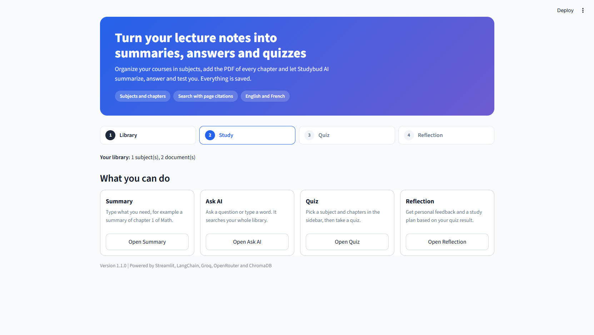
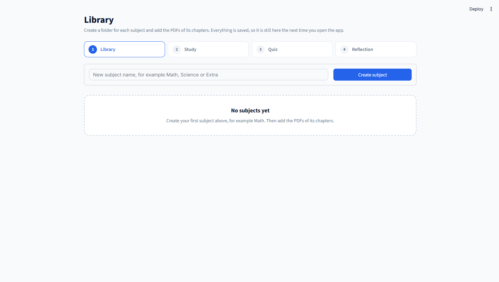
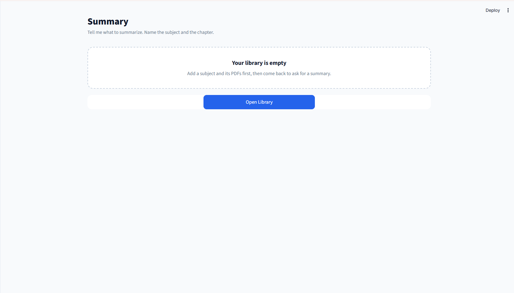
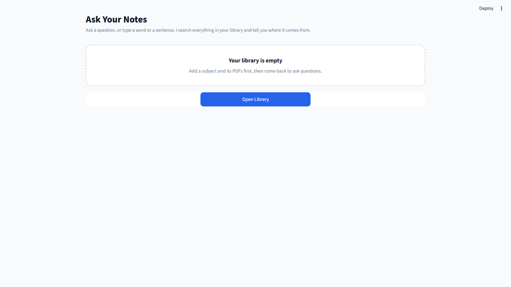
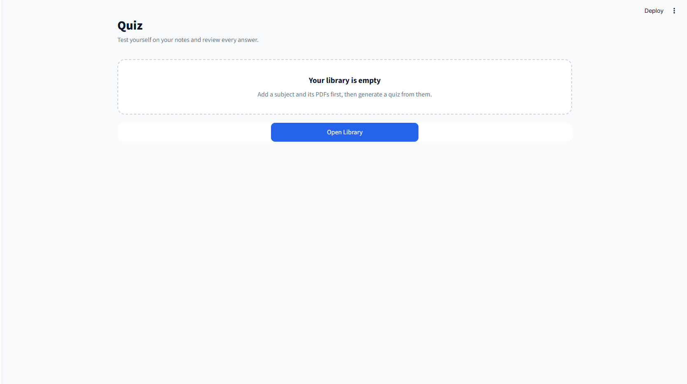
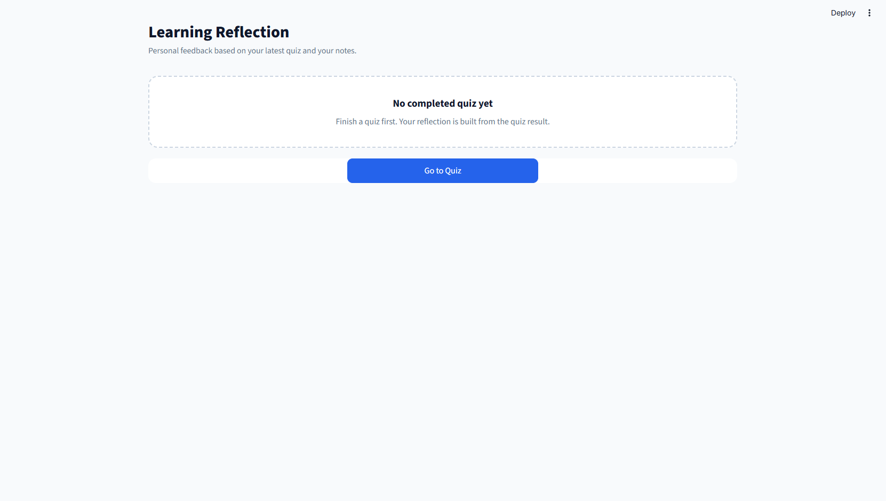

# Studybud AI

### A study assistant with a library of subjects and chapters, using Retrieval-Augmented Generation (RAG), agent-style service roles and task-based LLM selection


---

## Project Overview

You organize your courses like folders in Drive: **subjects** (Math, Science, Extra...) that contain **documents** (the PDF of each chapter). Everything is saved on disk, so your library is still there the next time you open the app. You can then:

- **Summarize** by typing what you need ("a summary of chapter 1 of math").
- **Ask** a question, a word or a sentence: the app searches your whole library and tells you where the answer comes from (subject, document, page).
- **Take quizzes** on the subject and chapters you select in the sidebar.
- Get a **personal reflection** from the quiz result.

Responses can be generated in **English** or **French**.

## Key Features

- Permanent library (SQLite + ChromaDB): create, rename and delete subjects and documents; add many PDFs at once; duplicates are detected.
- Page-aware chunking; every chunk is tagged with its document, so searches can be limited to chosen chapters.
- **Summary by prompt**: the app works out the subject and chapters from your sentence (rule-based, no AI call). Several chapters are condensed one by one and then combined.
- **Ask AI**: hybrid retrieval, exact word/sentence matches plus semantic search; search everything or one subject; answers cite subject / document / page; streaming answers.
- **Quiz**: MCQ, True/False or Mixed, 5 to 20 questions, subject and chapter selection, instant feedback option, per-question review.
- **Adaptive quiz**: "Focus on my weak topics" retrieves the passages about the weak topics of the previous quiz.
- **Reflection**: built from the structured quiz message and the passages of the quizzed chapters; progress chart across quizzes.
- Task-based provider routing (Groq / OpenRouter) with runtime fallback.

## Technology Stack

| Category | Technology | Purpose |
|----------|------------|---------|
| Language | Python 3.11 | Core development |
| Frontend | Streamlit | Multi-page web UI |
| LLM framework | LangChain | LLM clients |
| LLMs | Groq, OpenRouter | Generation |
| Vector DB | ChromaDB | Persistent semantic storage |
| Library DB | SQLite | Subjects and documents |
| Embeddings | Sentence Transformers (all-MiniLM-L6-v2) | Local embeddings (free) |
| PDF | PyMuPDF | Text extraction per page |
| Config | python-dotenv | API keys |

## LLM Selection Strategy

`AIProvider` routes by task when `provider="auto"`:

| Task | Preferred provider | Reason |
|------|--------------------|--------|
| Summary | Groq | Fast, low latency |
| Quiz generation / review | Groq | Fast structured output |
| Question answering | OpenRouter | Larger context, stronger reasoning |
| Reflection | OpenRouter | Longer, more detailed output |

If the preferred provider has no key **or the request fails** (rate limit, timeout), the other provider is tried. You only need one key.

## Architecture

A layered, service-based design. The "agents" are specialised service classes with a fixed pipeline (they do not plan or choose tools autonomously); the adaptive behaviour is that the Quiz Agent's output (weak topics) steers retrieval and the next quiz.

| Layer | Responsibility |
|-------|----------------|
| Presentation (`app.py`, `pages/`) | Streamlit pages, sidebar, session state |
| Application (`services/`) | Documents, scope resolution, summary, chat, quiz, reflection |
| Retrieval (`rag/`) | Library (SQLite), chunking, embeddings, ChromaDB search and context building |
| AI (`agents/`) | Provider routing/fallback and the `QuizResultMessage` contract |

| Agent role | Where | Responsibility |
|------------|-------|----------------|
| Document Processing | `services/document_service.py` | Hash, extract, chunk (with pages), embed, store |
| Scope | `services/scope_service.py` | Turn "chapter 1 of math" into documents |
| Retrieval | `rag/vector_store.py` | Filtered semantic + exact search, evenly-sampled context |
| Summary | `services/summary_service.py` | Per-chapter and combined summaries |
| Question Answering | `services/chat_service.py` | Grounded answers with citations |
| Quiz | `services/quiz_service.py` | Generate, score, review, publish `QuizResultMessage` |
| Reflection | `services/reflection_service.py` | Feedback from the message + retrieved passages |
| Routing | `agents/ai_provider.py` | Task-based selection and fallback |

### Quiz Agent -> Reflection Agent message

```json
{
  "message_type": "quiz_result",
  "version": 1,
  "score": 85.0,
  "correct_answers": 17,
  "wrong_answers": 3,
  "total_questions": 20,
  "status": "PASS",
  "weak_topics": ["Embeddings", "Vector Databases"],
  "strong_topics": ["Retrieval-Augmented Generation"],
  "recommendation": "Review embedding concepts before attempting another quiz."
}
```

### How each feature uses the library

| Feature | Context sent to the LLM |
|---------|------------------------|
| Ask AI | Exact matches + top-k semantic chunks, from all subjects or one subject (true RAG) |
| Summary | One chapter: the chapter (evenly sampled if long). Several chapters: each condensed, then combined |
| Quiz | The selected chapters (evenly sampled); weak-topic chunks are retrieved first when requested |
| Reflection | Chunks of the quizzed chapters retrieved for the weak topics + evenly sampled remainder |

## Project Structure

```text
Studybud-AI/
├── agents/            # ai_provider.py (routing + fallback), messages.py
├── assets/screenshots/
├── components/        # styles.py, ui.py
├── data/              # library.db, chroma_db/, uploads/ (created at runtime, git-ignored)
├── models/
├── pages/             # Library, Summary, Ask_AI, Quiz, Reflection
├── prompts/
├── rag/               # library.py, chunker.py, embeddings.py, vector_store.py
├── services/          # document, scope, chat, summary, quiz, reflection
├── tests/             # smoke tests + eval_retrieval.py
├── utils/             # file_loader.py, session.py, language.py, json_utils.py, markdown_utils.py
├── .streamlit/config.toml
├── app.py
├── config.py
├── requirements.txt
├── .env.example
└── README.md
```

## Installation (100% free)

You need Python 3.10-3.12 (3.11 recommended), Git and **one** free API key: [Groq](https://console.groq.com) and/or [OpenRouter](https://openrouter.ai) (use a model ending in `:free`). Embeddings and both databases run locally.

```bash
git clone https://github.com/sawsenbffarhat/Studybud-AI.git
cd Studybud-AI

python -m venv venv
# Windows:      venv\Scripts\activate
# Linux/macOS:  source venv/bin/activate

pip install --upgrade pip
pip install torch --index-url https://download.pytorch.org/whl/cpu   # small CPU build
pip install -r requirements.txt

cp .env.example .env     # Windows: copy .env.example .env   then add your key(s)
streamlit run app.py
```

Open http://localhost:8501. The first start downloads the embedding model (~90 MB).

### Configuration (`.env`)

```env
GROQ_API_KEY=your_groq_api_key
OPENROUTER_API_KEY=your_openrouter_api_key
GROQ_MODEL=openai/gpt-oss-120b
OPENROUTER_MODEL=google/gemma-4-26b-a4b-it:free
```

Chunk size, retrieval depth and context budget are in `config.py`.

## Usage

1. **Library**: create a subject (for example Math), then add the PDFs of its chapters. Name each file after its chapter (`Chapter 1.pdf`) so you can ask for it later; you can rename documents in the library.
2. **Summary**: type, for example, "I need a summary of chapter 1 of math", "chapters 1 to 3 of science" or "the whole math subject".
3. **Ask AI**: ask a question or type a word; choose "All subjects" or one subject.
4. **Quiz**: pick the subject and chapters in the sidebar, choose difficulty and length, answer, submit and read the review.
5. **Reflection**: generate feedback, then tick "Focus on my weak topics" in Quiz for a targeted quiz.

Your library is saved in `data/`. Back up that folder to keep it. Deleting `data/` resets the app.

## Deployment

The library is stored on the local disk, so the app is meant to run on your own computer. On Streamlit Community Cloud the disk is not permanent and a restart or redeploy erases the library, and every visitor would share one library. For a shared online version, use a hosted database and add logins.

**Source Code:** https://github.com/sawsenbffarhat/Studybud-AI.git

## Screenshots

Add your screenshots to `assets/screenshots/`.








## Retrieval Evaluation

Retrieval quality is measured with a script instead of qualitative claims. Write 10-20 questions about one of your PDFs, each with a keyword that must appear in the answering chunk:

```bash
cp tests/eval_questions.example.json tests/eval_questions.json   # then edit
python -m tests.eval_retrieval path/to/lecture.pdf tests/eval_questions.json
```

It prints the hit rate @ 1, 3 and 6 (the PDF is added to a temporary subject and removed afterwards). Record your results here:

| Document | Questions | Hit@1 | Hit@3 | Hit@6 |
|----------|-----------|-------|-------|-------|
| _run the script and fill in_ | | | | |

## Known Limitations

- PDF only; scanned PDFs (OCR) are not supported.
- Two levels only: subjects and documents (no nested folders).
- The summary request is understood by rule-based matching: name the subject and use the chapter number or the document name.
- Summaries of many chapters condense each chapter first, so fine details can be lost; at most 8 documents per summary.
- Free API tiers are rate-limited; the app falls back to the other provider when it can.
- Single-user, local library: no accounts, and the library does not persist on free cloud hosting.
- Sinhala output quality depends on the chosen model.

## Future Improvements

- User accounts and a hosted database for an online, multi-user version
- OCR for scanned PDFs, hybrid keyword + semantic reranking
- Nested folders, tags, and moving documents between subjects
- Flashcards and study plans
- Agents that plan and pick tools autonomously (e.g. LangGraph)

## Author

**Roshini Nawanjala** - Undergraduate, Faculty of Information Technology, Horizon Campus, Sri Lanka
GitHub: https://github.com/roshini-nawanjala

## License

Developed for academic and educational purposes as part of a university assignment.

## Acknowledgements

Streamlit, LangChain, ChromaDB, Sentence Transformers, PyMuPDF, SQLite, Groq, OpenRouter, python-dotenv.
=======
# Studybud-AI
>>>>>>> 67c22123ca571b4ec91fd307b76f6e8ceb621eb3
